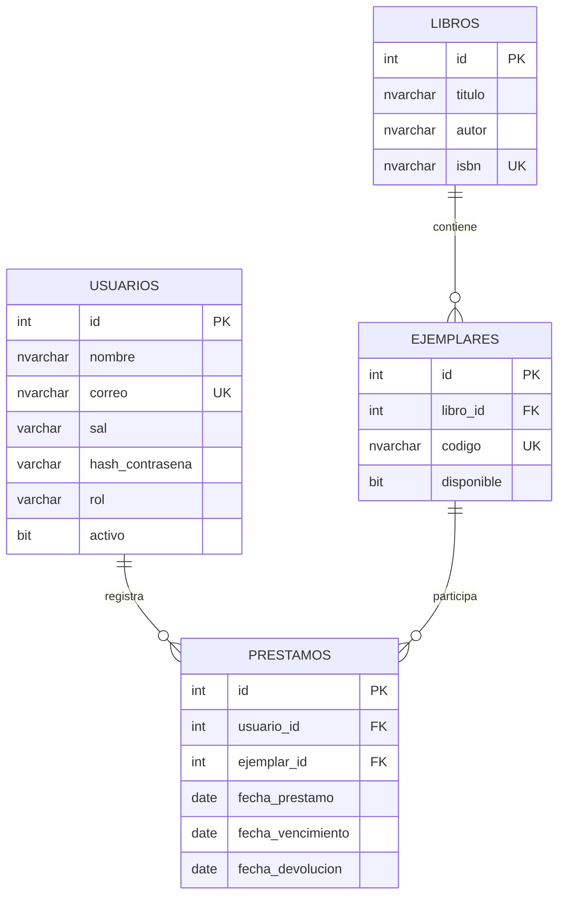

# Modelo de datos relacional inicial

Esquema: `BibliotecaSanLucas`, SQL Server.

**Reglas de integridad:** correo, ISBN y código de ejemplar son únicos; préstamos requieren usuario y ejemplar existentes; préstamos activos son únicos por ejemplar (índice único filtrado por fecha de devolución nula); fechas de vencimiento y devolución no preceden a la fecha del préstamo. Los roles permitidos por el código actual son `ADMINISTRADOR`, `OPERADOR` y `LECTOR`.

**Proceso transaccional:** registrar préstamo = (1) comprobar ejemplar disponible, (2) marcar ejemplar no disponible, (3) insertar préstamo en la misma transacción. Devolver = (1) actualizar fecha de devolución, (2) liberar ejemplar en la misma transacción. Si falla un paso, se aplica rollback a ambos cambios.

**Pendientes de validación con stakeholders:** plazo de préstamo (actualmente 7 días), margen de alerta (actualmente 2 días), políticas de reservas, renovaciones y roles definitivos. Este modelo reproduce el comportamiento existente; no presupone aprobación institucional.
